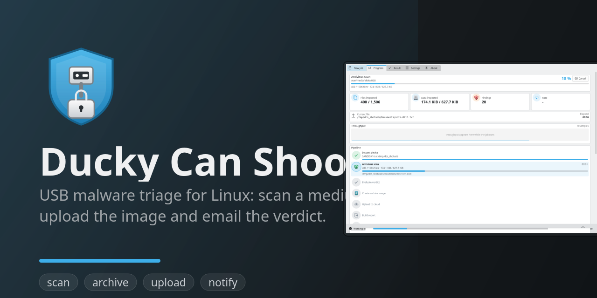
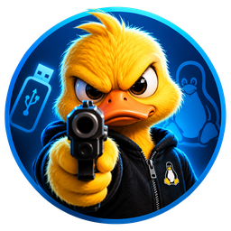
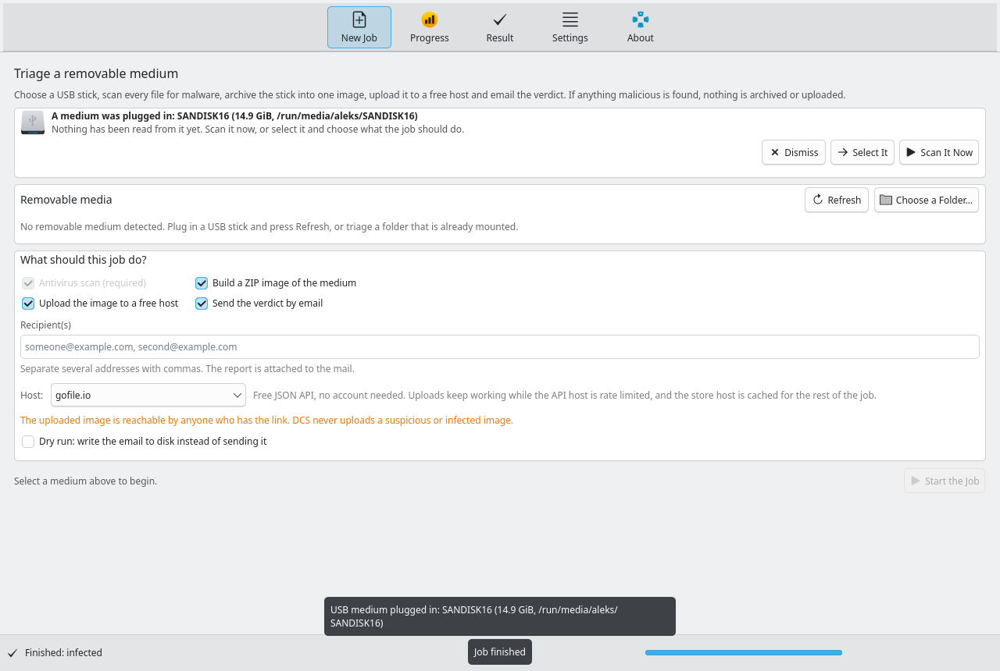

<p align="center">
  
</p>

<p align="center">
  <a href="LICENSE"></a>
  <a href="https://github.com/Linux-Alex/ducky-can-shoot/actions/workflows/ci.yml"></a>
  
  
  
  
  
  <a href="CONTRIBUTING.md"></a>
</p>

<p align="center">
  
</p>

<h1 align="center">Ducky Can Shoot</h1>

<p align="center"><b>USB malware triage for Linux.</b><br>
Pick a plugged-in medium, scan every file, archive it into one image, upload that
image to a free host and email the verdict. If anything malicious is found,
nothing is archived and nothing is uploaded.</p>

---

## The situation it is built for

Somebody hands you a USB stick. A colleague, a client, a conference bag, a
parking lot. You want to know two things before you touch it: **is it safe**, and
**can I forward a copy to the person who asked**.

DCS answers both in one run:

1. It scans the whole medium with **ClamAV** when it is installed, and always
   with a **built-in heuristic engine** that knows the tricks a signature scanner
   misses on removable media: Duckyscript/BadUSB payload scripts, autorun.inf
   boot entries, PowerShell download cradles, double extensions, macro
   documents, PDF JavaScript, packed binaries with injection APIs, archive
   bombs, encrypted archives and ransomware precursors. **YARA** rules and a
   **known-hash intelligence** engine can be switched on as well, see
   [Optional engines](#optional-engines).
2. It compresses the medium into one zip (or 7z, optionally split into volumes).
3. It uploads that image to a free host and emails the verdict, the numbers and
   the interesting findings to whoever should know (the HTML report and a CSV of
   the findings are attached).
4. **Only a clean image is ever published.** An infected medium is scanned,
   reported and emailed, and that is all: no archive, no upload, no link. The
   tool exists so that a suspicious stick cannot become a shared one by accident.

Everything runs locally except the upload you asked for.

## Optional engines

Two more engines exist, both off until you configure them:

- **YARA** (`scan.engines = ["clamav", "heuristic", "yara"]`) runs a rule pack of
  your choice over the whole medium. Rules are the cheapest way to cover what
  generic signatures miss on removable media - Duckyscript payloads, autorun
  and shortcut tricks, download cradles - and a rule set such as Neo23x0's
  [signature-base](https://github.com/Neo23x0/signature-base) is free. Point
  `scan.yara.rules` at a directory, or try it once with
  `dcs scan /media/stick --yara-rules ~/rules`.
- **Hash intelligence** (`scan.engines = ["clamav", "heuristic", "intel"]`) reads
  extra `sha256 <name>` block lists you keep, and - only if you ask for it
  twice - asks VirusTotal or MetaDefender Cloud about files it does not know.
  The default is `lookup = "off"`: nothing leaves the machine. `"hash"`
  sends only SHA-256 digests; `"upload"` plus `upload_unknowns = true`
  also sends unknown files, and the report names every file that was uploaded.

See [docs/CONFIGURATION.md](docs/CONFIGURATION.md) for the keys and
[docs/EXTENDING.md](docs/EXTENDING.md) for the engine contract. Every engine
that takes part is listed with its version in the result, and an engine that
could not run is a warning in the report rather than a clean verdict.

## Screenshots

| New job | Live run |
| --- | --- |
|  |  |

| Result: clean | Result: infected |
| --- | --- |
|  |  |

| Settings | Installing the optional ClamAV |
| --- | --- |
|  |  |

The interface is Qt Quick with **Kirigami**, so it uses your Plasma colour scheme,
icon theme and fonts. The screenshots were rendered with the KDE style; your
window will look like the rest of your desktop.

They are not mock-ups: `make screenshots` renders them from real pipeline runs
over two synthetic media (one clean, one infected), with the upload host
replaced by a stand-in so that refreshing the documentation never publishes a
file. `scripts/make-screenshots.py` also checks the outcome before it saves an
image: the "clean" shot is only written when the run really came out clean with
no findings.

## Quick start

### 1. Install the runtime

```bash
# Debian / Ubuntu / Kubuntu / Mint
sudo apt install python3 python3-pyqt6 python3-pyqt6.qtqml python3-pyqt6.qtquick \
  qml6-module-org-kde-kirigami qml6-module-qtquick-controls \
  qml6-module-qtquick-layouts qml6-module-qtquick-dialogs \
  qml6-module-qtquick-templates qml6-module-qtqml-workerscript \
  libqt6svg6 qt6-svg-plugins zip udisks2 util-linux

# Fedora
sudo dnf install python3 python3-pyqt6 kf6-kirigami qt6-qtdeclarative zip udisks2 util-linux

# Arch / Manjaro
sudo pacman -S python python-pyqt6 kirigami qt6-declarative zip udisks2 util-linux
```

On Ubuntu the Qt 6 and Kirigami 6 packages above mean **26.04 or newer**: 24.04
ships no KDE Frameworks 6 at all, so `qml6-module-org-kde-kirigami` does not
exist there and apt refuses the whole command. Qt has to come from the same build
as the QML modules, which is why distribution packages are preferred over a wheel.

### 2. Install Ducky Can Shoot

```bash
git clone https://github.com/Linux-Alex/ducky-can-shoot.git
cd ducky-can-shoot
./scripts/install.sh          # user level: ~/.local, no root needed
```

Or, on Debian and Ubuntu, from the `.deb` of a release (see
[the releases page](https://github.com/Linux-Alex/ducky-can-shoot/releases)):

```bash
sudo apt install ./ducky-can-shoot_0.2.3-1_all.deb
```

The script builds a virtual environment that can see the distribution packages,
links `dcs` into `~/.local/bin`, installs the desktop entry and the icon, and
writes a default configuration.

Prefer to keep everything local? Run it straight from the checkout:

```bash
./bin/dcs                 # the graphical interface
./bin/dcs doctor          # check every dependency and the configuration
```

### 3. Add the optional virus engine

Heuristics alone already catch the USB-specific attacks, but signature scanning
needs ClamAV. The interface installs it for you: press **Install ClamAV** on the
New job tab (or in Settings), check the plan it shows, and confirm. Your password
goes to polkit, never to DCS. From a terminal:

```bash
dcs install-clamav            # detect the distribution, show the plan, run it
dcs install-clamav --dry-run  # just print the plan and the commands
```

<details>
<summary>Or install it yourself</summary>

```bash
sudo apt install clamav clamav-daemon clamav-freshclam && sudo freshclam   # Debian / Ubuntu
sudo dnf install clamav clamd clamav-update && sudo freshclam              # Fedora
sudo pacman -S clamav && sudo freshclam                                    # Arch
```

</details>

## The first run

Plug in the stick, start `dcs`, pick the medium from the list, decide what the job
should do, and press **Start the job**. The live view walks through seven stages
and shows what is happening at each one:

```text
inspect   device metadata, free space, which engines are available
scan      every file: ClamAV + heuristics, live counter, rate, ETA, findings
verdict   clean / suspicious / infected, from the findings and their severities
archive   one zip (or 7z, optionally split), with the SHA-256 of the image
upload    the image to a free host, byte level progress
report    self contained HTML, plain text, findings CSV and JSON
email     the verdict, the numbers, the link when it is safe, report attached
```

The same run headless, which is how you would put it in a script:

```console
$ dcs devices
NODE          LABEL                     SIZE  FS      BUS   MOUNT
/dev/sdb1     SANDISK16             14.9 GiB  vfat    USB   /run/media/aleks/SANDISK16

$ dcs run --device /dev/sdb1 --to someone@example.org --yes
==> inspect: collecting device information
     inspect          ok                    00:00 - SANDISK16 at /run/media/aleks/SANDISK16
==> scan: engines: ClamAV 1.5.4, DCS built-in heuristics 1.0
     12480/12480 files - 3.4 GiB/3.4 GiB - 100.0% - 214.6 MiB/s - ETA 00:00
     CRITICAL Eicar-Test-Signature - /run/media/aleks/SANDISK16/eicar.com
     HIGH     Rubber Ducky / BadUSB payload script - /run/media/aleks/SANDISK16/payload.txt
     scan             ok                    00:16 - 8 findings in 12480 files (infected)
==> verdict: evaluating the findings
     verdict          ok                    00:00 - 5 threatening file(s)
     archive          skipped               --:-- - the medium is infected: no archive was
                        created and nothing was uploaded, so malware never leaves this machine
==> report: rendering the report
     report           ok                    00:00 - 4 file(s) in ~/.local/share/dcs/reports
==> email: notifying someone@example.org
     email            ok                    00:01 - sent to someone@example.org

VERDICT: INFECTED    Ducky Can Shoot 0.2.3
------------------------------------------------------------------------
  medium        : SANDISK16 (/run/media/aleks/SANDISK16)
  files scanned : 12,480 (3.4 GiB)
  findings      : 8 (5 threatening)
  duration      : 00:18
  upload        : the medium is infected: no archive was created and nothing was uploaded
  email         : sent to someone@example.org
  report        : ~/.local/share/dcs/reports/DCS_SANDISK16_20260113-204512.html
------------------------------------------------------------------------
```

A clean medium walks the same path but continues: the image is built, uploaded,
and the email carries the download link.

Exit codes make the result scriptable: **0** clean, **1** suspicious or infected,
**2** the run failed or was cancelled.

## Features

| | |
| --- | --- |
| **Two scan engines** | ClamAV through clamdscan (daemon, `--fdpass`, fast on thousands of small files) or the stand-alone clamscan, chosen automatically and reported; plus a dependency-free heuristic engine that explains the evidence behind every finding |
| **Built for USB attacks** | Duckyscript/HID payload scripts, autorun.inf launchers, BadUSB tooling, PowerShell encoded commands and download cradles, pipe-into-shell, base64-into-shell, double extensions, Office macros with automatic entry points, OOXML remote templates, PDF JavaScript, packed PE with injection or keylogging APIs, suspicious shortcuts, registry persistence, ransomware precursors, zip bombs, password protected archives, known hashes |
| **Removable media handling** | lsblk for discovery, udisks2 for mounting without root, or triage any folder instead |
| **Archiving** | zip or 7z, optional volume splitting, free space pre-check, a shared SHA-256 for the image, a Python fallback when the archivers are missing |
| **Seven upload hosts** | gofile.io by default (free JSON API, no account), plus litterbox, temp.sh, x0.at, catbox, tmpfiles.org and pixeldrain, behind one adapter interface with streaming uploads, retries and host checksum verification |
| **Reports** | self contained HTML, plain text, findings CSV and machine readable JSON, written atomically |
| **Email** | HTML and text body, verdict, numbers, findings, the link when safe, report attached, Bcc supported, and a dry run that writes the message to disk instead of sending it |
| **Live interface** | seven stages with their own progress, files/bytes counters, throughput chart, current file, findings as they appear, log pane |
| **Honest about coverage** | files skipped for size, unreadable paths, a missing ClamAV and a stale signature database are reported in the interface, the report and the email |
| **USB detection** | Off by default. Turn it on and DCS can notify you when a stick is plugged in (with a button that opens it), open itself on the new medium, or run the whole job automatically - see [USB detection](#usb-detection-when-you-plug-something-in) |
| **Nothing executable is run** | the medium is read, never written, and nothing found on it is ever executed |
| **Updates** | Checks the GitHub release page when it starts (on by default, and from the settings page any time), then downloads, installs and restarts itself - including the background watcher - when you press the button. A git checkout is told to `git pull` instead of being touched |

## USB detection (when you plug something in)

Ducky Can Shoot is a tool you start, not a service that watches you. It can
nevertheless react on its own, and you choose how far that goes: the setting is
**off by default** and lives in **Settings → USB detection**, or in
`[watch] mode` in the configuration file.

| Mode | What happens when a medium appears |
| --- | --- |
| **Do nothing** (default) | Nothing watches, nothing opens. DCS stays a tool you start. |
| **Notify me** | A desktop notification with an **Open Ducky Can Shoot** button. Nothing is read from the medium until you press it. |
| **Open with it selected** | DCS opens with the new medium already selected; the scan still waits for you. |
| **Open and run** | DCS opens and runs the whole job: scan, archive, upload, and the email when a recipient is configured. Without a recipient it stops after the report and shows the link. |



While a window is open it does the watching itself; to react while DCS is closed,
tick **Start the watcher with my session**. That writes one autostart entry
(`~/.config/autostart/org.kde.dcs.watch.desktop`) *and* starts the watcher right
away - the entry alone only takes effect at the next login, which is why the
settings page shows the state next to a **Start Now** button. In notification
mode the button in the notification is what opens DCS, and `dcs watch --test`
sends one to check that it works. The installer offers the same choice at the end,
and "do nothing" is the default answer:

```bash
./scripts/install.sh                 # asks, default: do nothing
./scripts/install.sh --watch=notify  # off | notify | open | open_run
```

From a terminal:

```bash
dcs watch --status                   # mode, autostart entry, watcher, log file
dcs watch --start                    # make sure something is listening right now
dcs watch --test                     # does the notification's button work here?
dcs config set watch.mode open_run   # not for you? "off" is one command away
```

Notifications are sent over D-Bus rather than through `notify-send`, which drops
the action buttons on systems where it thinks the server cannot show them
(Plasma 6.6 is such a system) - and a notification without its button defeats the
point of notification mode.

The watcher polls `lsblk` every three seconds. It never mounts, never reads a
file, never scans and never needs root: it looks at the list of block devices and
then hands the medium to the interface, which is where every decision still
happens. A stick with two partitions counts as one medium, and a running window
plus the background watcher never both react.

## Upload hosts

Every host is reachable without an account. The table is the result of live
testing (see [docs/research/cloud-upload-apis.md](docs/research/cloud-upload-apis.md)),
which is also why the defaults are what they are: several well known free hosts
are no longer usable anonymously.

| Provider | Id | Limit | Notes |
| --- | --- | --- | --- |
| gofile.io | `gofile` | no published limit | default; free JSON API, keyless, store host cached, uploads survive the API host being rate limited |
| litterbox | `litterbox` | 1 GB | temporary (72 h), deleted automatically |
| temp.sh | `tempsh` | 4 GB | largest anonymous limit found; three day expiry |
| x0.at | `x0at` | 1 GB | successor of 0x0.st, whose uploads were disabled |
| catbox.moe | `catbox` | 200 MB | permanent store |
| tmpfiles.org | `tmpfiles` | 100 MB | short lived (1 h to 48 h) |
| pixeldrain | `pixeldrain` | 20 GB | needs an API key; anonymous uploads were removed |

`dcs providers` prints the same list, and `upload.provider` selects one.

## Safety, privacy and what a clean verdict means

**Safety guarantees**

1. A medium that is not clean is **never** archived and **never** uploaded. The
   verdict and the findings are emailed; that is the whole output.
2. Publishing a non-clean image additionally requires an explicit confirmation
   (`--yes` on the command line, a dialog in the interface).
3. DCS never writes to the medium and never executes anything found on it.
4. Uploaded files are reachable by anyone who has the link. The interface warns
   about it, the report says so plainly, and you can keep everything local with
   `--no-upload`.
5. Passwords are collected by polkit or sudo, never by DCS, and secrets are read
   from the environment or a helper command instead of the configuration file.

**What a clean verdict does not mean.** ClamAV detects signatures, not unknown
malware; the heuristics detect known attack shapes, not everything. A clean
verdict says "nothing I could see is malicious", never "this medium is
trustworthy". RAR, 7z and CAB contents are only inspected when ClamAV is
available, encrypted archives cannot be inspected at all, and files above
`scan.max_file_size_mb` are reported as a coverage gap instead of being read.
The full reasoning is in [docs/THREAT-MODEL.md](docs/THREAT-MODEL.md).

## Command line at a glance

```bash
dcs                          # the graphical interface (same as dcs gui)
dcs devices                  # what is plugged in
dcs doctor                   # is this machine ready? what is missing?
dcs scan /media/$USER/STICK  # scan only, print the findings
dcs run --device /dev/sdb1 --to me@example.org          # the whole job
dcs run --path ./incoming --no-upload --dry-run-email   # nothing leaves the machine
dcs install-clamav --dry-run # how ClamAV would be installed here
dcs config show              # the effective configuration
dcs config set watch.mode notify   # react when a stick is plugged in (off by default)
dcs watch --status           # what the watcher would do right now
```

Every subcommand, flag and exit code: **[docs/CLI.md](docs/CLI.md)**.

## Configuration

`~/.config/dcs/config.toml` (written on first use), or `/etc/dcs/config.toml` for
a machine wide default, or whatever `--config PATH` points at.

```toml
[scan]
engines = ["clamav", "heuristic"]     # both, in this order
blocking_severity = "high"            # from which severity a medium counts as infected

[archive]
format = "zip"                        # zip or 7z
split_size_mb = 0                     # 0 = one file, else volumes of this size
when = "clean"                        # clean | always | never

[upload]
provider = "gofile"
upload_when = "clean"                 # never publish a malicious image

[email]
enabled = true                        # off until a server and a recipient are set
smtp_host = "smtp.example.org"
from_addr = "dcs@example.org"
to_addrs = ["security@example.org"]
password_command = "pass show mail/dcs"   # or export DCS_SMTP_PASSWORD
```

Secrets never have to live in the file: every one of them can come from an
environment variable (`DCS_SMTP_PASSWORD`, `DCS_GOFILE_TOKEN`,
`DCS_PIXELDRAIN_API_KEY`) or a helper command. Every key, default and environment
variable: **[docs/CONFIGURATION.md](docs/CONFIGURATION.md)**.

## Building and packaging

```bash
make deb                         # dist/ducky-can-shoot_<version>-1_all.deb
make build                       # sdist and wheel in dist/
./scripts/install.sh             # user level install with desktop entry and icon
pipx install .                   # or: pip install --user .
```

The **Debian package** is architecture independent and bundles nothing: it depends
on the distribution's Python, PyQt6, Kirigami and the Qt SVG plugins, exactly the
packages the quick start asks for, so a second copy of Qt never ends up on the
system. It installs `dcs` and `dcs-gui` in `/usr/bin`, the desktop entry, the
AppStream metadata, the icon set, a man page in `/usr/share/man/man1/dcs.1.gz`
and `/etc/xdg/autostart/org.kde.dcs.watch.desktop` - that last one is what lets
the USB watcher run from login, and it stays inactive until a watch mode is
enabled:

```bash
make deb
sudo apt install ./dist/ducky-can-shoot_0.2.3-1_all.deb
man dcs
```

The wheel ships the QML interface, the icon and the hash list, so an installed DCS
is self contained. `packaging/` holds the desktop entry, the icons, the AppStream
metadata, the man page and the `.deb` skeleton; the command is also exposed as
`dcs-gui` and `ducky-can-shoot` for menu integration.

Pushing a tag builds the wheel, the sdist and the `.deb` and attaches all three to
a GitHub release, with the changelog section of that version as the notes: see
[the release checklist](docs/PUBLISHING.md#making-a-release).

## How this project was built (AI assistance)

In the interest of being upfront: **Ducky Can Shoot was built with substantial AI
assistance.**

- The requirements, safety rules and design decisions are human: what a job does,
  that an infected medium is never uploaded, which hosts to support, what the
  interface has to show.
- Large parts of the code, the tests, the documentation and the interface were
  written by AI agents (DeepSeek Harness sessions) under human direction and
  review, then verified before they were kept.
- What "verified" means here: 830 automated tests, live upload round trips
  against real hosts with checksum comparison, scans of a purpose-built sample
  medium with EICAR and synthetic malware shapes, and repeated runs of the
  interface in a real Plasma session. That last one is how several layout and
  style bugs were found: a user reported them from their own machine, and they
  were fixed and pinned by tests.
- Bugs found this way are in the [CHANGELOG](CHANGELOG.md), including the one that
  mattered most: uploads larger than 1 MiB used to be truncated silently. A user
  noticed a corrupt download; the cause was a file-protocol bug in the upload
  reader, and the fix is covered by a test that asserts every byte arrives.
- The **application artwork** is the maintainer's: two illustrations of the duck
  holding the pistol, drawn with an image generator and kept in `docs/images/`
  (`detail-icon.png` and `less-detail-icon.png`). `scripts/make-icons.py` cuts
  the white background out of them and renders the nine sizes a theme asks for -
  the flatter drawing for the small sizes, the detailed one from 128 px up - and
  the About page shows the detailed one. It is an illustration rather than a
  vector, so there is no SVG of it and no monochrome variant; the interface's own
  icons come from your Plasma icon theme and stay native.

Practical consequences: the code and the prose are unusually uniform, comments
explain intent rather than history, and the commit log is descriptive. Treat
AI-written code with the same scepticism you would treat any contributed code,
and please open an issue if something reads like it was generated without being
understood. Contributions written with AI help are welcome under the same
standard of testing and review as anything else, see
[CONTRIBUTING.md](CONTRIBUTING.md).

## Project layout

```text
src/dcs/core/          headless core: no Qt imports, used by the CLI, the tests and the GUI
  config.py            configuration, secrets, validation
  device.py            removable media discovery and mounting
  scanner/             engine interface, ClamAV, the built-in heuristics and their rules
  archiver.py          zip/7z creation with progress and volume splitting
  upload/              provider interface, gofile and the simple hosts
  report.py            HTML, text, CSV and JSON reports
  notify/              SMTP delivery and the message bodies
  pipeline.py          the seven stages, the skip rules and the verdict
  installer.py         installing ClamAV through the system package manager
src/dcs/gui/           PyQt6 facade, Qt models and the QML interface (Kirigami)
src/dcs/cli.py         the dcs command
tests/                 830 tests, hermetic: no network, no real device, fake engines
docs/                  architecture, configuration, CLI, troubleshooting, threat model, roadmap
bin/dcs                run the checkout without installing
scripts/               install.sh, uninstall.sh
packaging/             desktop entry and icon
```

- [docs/ARCHITECTURE.md](docs/ARCHITECTURE.md): module map, the event and sink design, threading, the stage flow
- [docs/CONFIGURATION.md](docs/CONFIGURATION.md): every key with its default,
  including the optional YARA and hash-intelligence engines
- [docs/CLI.md](docs/CLI.md): the command line reference
- [docs/TROUBLESHOOTING.md](docs/TROUBLESHOOTING.md): when something does not work
- [docs/ROADMAP.md](docs/ROADMAP.md): what 0.2 should contain, and the plan to move the hot paths to Rust or C++

## Contributing

Issues and pull requests are welcome. The short version: run `python3 -m pytest`
and `ruff check src tests` before opening a PR, keep the core free of Qt imports,
and give every detection rule the evidence it relies on.
[CONTRIBUTING.md](CONTRIBUTING.md) has the details, including how to add a
detection rule, a scan engine or an upload provider.

## Credits

Built on the work of others: [ClamAV](https://www.clamav.net/) for signature
scanning, [Qt](https://www.qt.io/) and [Kirigami](https://invent.kde.org/frameworks/kirigami)
for the interface, [PyQt6](https://riverbankcomputing.com/software/pyqt/) for the
bindings, [requests](https://requests.readthedocs.io/) for HTTP, and
[util-linux](https://github.com/util-linux/util-linux) plus
[udisks](https://github.com/storaged-project/udisks) for device handling.

## License

GPL-3.0-or-later. See [LICENSE](LICENSE).
