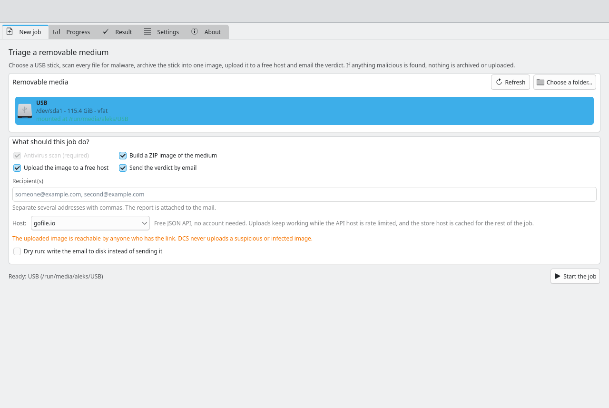
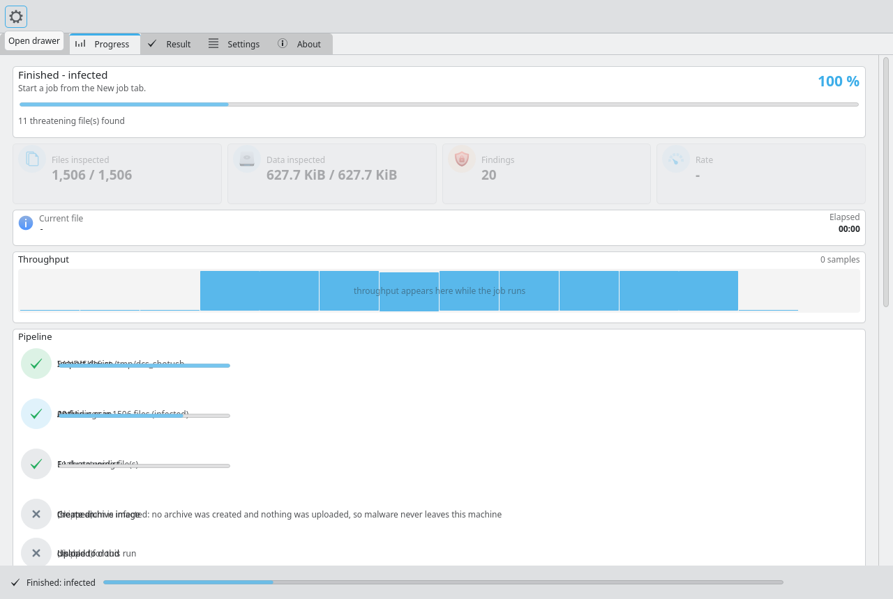
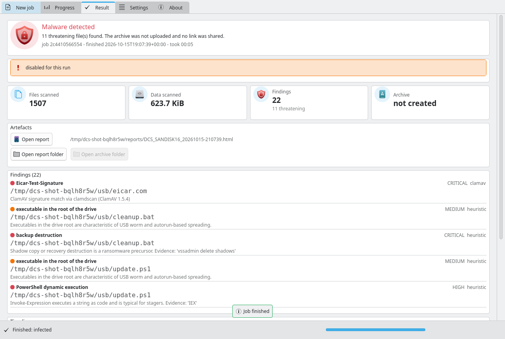
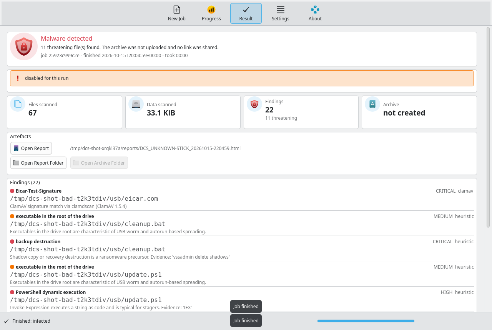
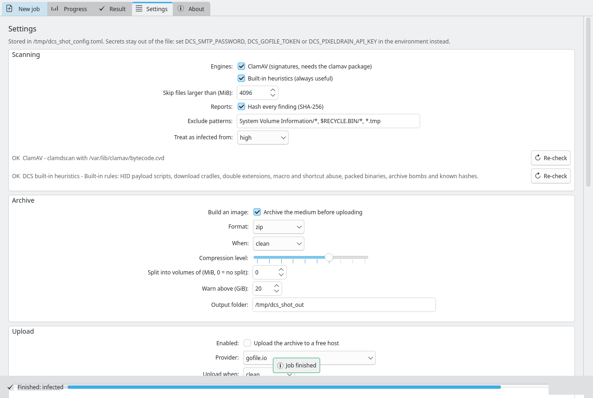
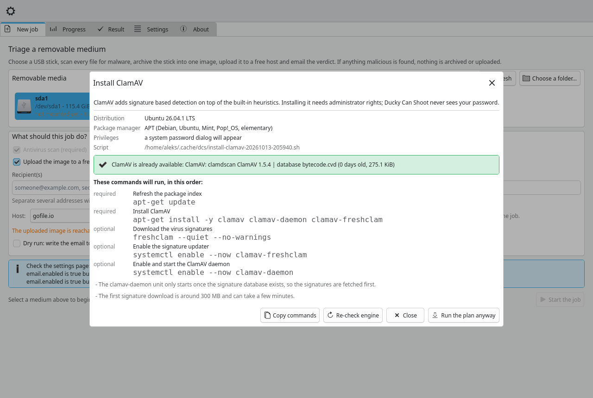

# Ducky Can Shoot (DCS)

**USB malware triage for Linux: scan a medium, archive it into one image, upload
that image to a free host and email the verdict.**

Ducky Can Shoot is a defensive forensics helper for the moment somebody hands you
a USB stick you do not trust. You pick the plugged-in medium (or any directory),
DCS walks every file with ClamAV when it is installed and with a built-in
heuristic engine that looks for the things signature scanners miss: Rubber
Ducky/BadUSB payload scripts, PowerShell download cradles, double-extension
executables, autorun.inf boot scripts, macro documents, PDF JavaScript, packed
binaries with injection APIs, archive bombs, encrypted archives, registry
persistence and ransomware precursors. It then compresses the whole medium into
one zip or 7z image (optionally split into volumes), uploads that image to a free
host (gofile.io by default) and sends an SMTP mail with the verdict and the
download link. **When anything malicious is found, nothing is archived and
nothing is uploaded**: only the verdict and the report leave the machine. The
graphical interface is a live view of every stage with file and byte counters,
throughput, ETA, findings as they appear and a log pane.

DCS never writes to the medium it inspects, and it never executes anything found
on it.

---

## Screenshots

Captured from the running application. The window is 1280x860 and rendered
offscreen, so your own colours, icons and fonts come from your Plasma theme.

### New job

Pick the medium, decide what the job should do, start it.



### Live run

Every stage with its own progress, the running counters, throughput, the current
file and findings as they appear.



### Result





### Settings



### Command line

```console
$ dcs scan /media/$USER/STICK
==> scan: engines: ClamAV 1.5.4, DCS built-in heuristics 1.0
    48321/48321 files · 12.4 GiB/12.4 GiB · 100.0% · 214.6 MiB/s · ETA 00:00
    CRITICAL Eicar-Test-Signature · /media/aleks/STICK/eicar.com
    HIGH     Rubber Ducky / BadUSB payload script · /media/aleks/STICK/payload.txt
VERDICT: INFECTED
  2 finding(s) in 48321 files (12.4 GiB) in 00:59
$ echo $?
1
```

### Verdict email

The message carries the verdict, the numbers, the findings worth reading and the
download link when the medium is clean. The HTML report and the findings CSV are
attached.

---

## Features

- **Two scan engines.**
  - **ClamAV** through clamdscan (daemon, `--fdpass`, fast on thousands of small
    files) or clamscan (stand-alone, fed a large batch). The front end that
    actually works is chosen automatically and reported; a stale signature
    database produces a warning.
  - **Built-in heuristics**, dependency free and always available. The engine
    reads file names, headers and embedded text and reports the evidence that
    triggered each finding. It catches Duckyscript/HID payloads, PowerShell
    encoded commands and download cradles, download-piped-into-shell and
    base64-into-shell patterns, double-extension executables, autorun.inf launch
    entries, Office macros with automatic entry points and remote template
    injection, PDF JavaScript and launch actions, packed PE files and
    injection/keylogging APIs, suspicious shortcuts, registry persistence keys,
    ransomware precursors (shadow copy deletion, Defender exclusions), zip bombs,
    password protected archives and known SHA-256 hashes.
- **Bounded coverage, stated honestly.** Archive contents in RAR, 7z and CAB
  files are only inspected when ClamAV is enabled; the report lists the files that
  were skipped, the paths that could not be read, and whether the scan ran without
  a signature engine (limited coverage).
- **One archive image.** zip or 7z, compression level 0 to 9, optional volume
  splitting. The external `zip` and `7z` tools stream and report per-file
  progress; a pure-Python `zipfile` fallback keeps the tool usable on a minimal
  system (it cannot split volumes and says so).
- **Free-host upload** with progress and cancellation: gofile.io by default, plus
  pixeldrain, litterbox, catbox, temp.sh, x0.at and tmpfiles.org.
- **SMTP notification** with a text and an HTML body, the job id and the verdict
  in the message headers, and the HTML report plus the findings CSV attached.
- **Reports** in HTML (self contained and dark-mode aware), plain text, a CSV of
  the findings and a machine readable JSON dump of the whole job.
- **Live GUI** (PyQt6, QML and Kirigami): device list polled through lsblk, mount
  and unmount through udisks2 without root, per-stage progress, throughput
  sparkline, streaming findings, log pane, settings editor and a dry-run mode.
- **Scriptable CLI** whose exit code carries the verdict, with JSON output for the
  scan, the job result and the environment check.
- **Safety interlocks**: `archive.when = clean` and `upload.upload_when = clean`
  by default, an explicit confirmation before uploading in the GUI, a refusal to
  publish a non-clean image without `--yes`, and secret resolution from the
  environment so a password never has to live in the config file.

---

## Requirements

| Requirement | Needed for | Notes |
| --- | --- | --- |
| Linux | everything | Developed and tested on Linux. Device discovery uses lsblk and udisksctl; Windows and macOS are not supported. |
| Python 3.11 or newer | everything | The configuration loader uses the standard library `tomllib`. |
| PyQt6 >= 6.5 | the GUI | Declared as a runtime dependency. The headless commands (`dcs scan`, `dcs run`, ...) never import Qt. |
| requests >= 2.28 | uploading | Only imported when an upload actually runs. |
| ClamAV (`clamscan` and/or `clamdscan` with a running `clamd`) | signature scanning | Optional but strongly recommended. |
| the `zip` and/or `7z` tools | archiving | Optional; without them DCS falls back to its slower Python zip writer, which cannot split volumes. |
| udisks2 (`udisksctl`) | mounting a stick that is not mounted yet | Optional; an already mounted medium needs nothing. |
| util-linux (`lsblk`) | device discovery | Present on every normal Linux system. |
| the Kirigami QML module (`org.kde.kirigami`) | the GUI | A distribution package, not a pip package. |

The core library (`dcs.core`) has no Qt imports at all: it needs only the Python
standard library, `requests` for uploads and the ClamAV binaries if that engine is
enabled. See [docs/ARCHITECTURE.md](docs/ARCHITECTURE.md).

---

## Installation

### Distribution package or a manual install

A distribution package is not published yet; this section describes installing
from a source tree into an isolated environment.

**PyQt6 must come from your distribution or from PyPI.** The declared dependency
is `PyQt6>=6.5`, so a plain `pip install` pulls it from PyPI. If your
distribution ships a Qt version you would rather use (Plasma users usually do),
install the distribution packages first, then install DCS without dependencies and
add the rest yourself:

```bash
# Debian / Ubuntu: Python, Qt, QML and the KDE runtime the interface needs
sudo apt install python3 python3-venv python3-pyqt6 python3-pyqt6.qtqml \
                 python3-requests qml6-module-org-kde-kirigami \
                 qml6-module-qtquick qml6-module-qtquick-controls \
                 qml6-module-qtquick-layouts qml6-module-qtquick-dialogs \
                 util-linux udisks2 zip p7zip-full

# Fedora / openSUSE equivalents
sudo dnf install python3 python3-pyqt6 python3-requests kf6-kirigami \
                 util-linux udisks2 zip p7zip
sudo zypper install python3 python3-qt6 python3-requests kirigami6 \
                    util-linux udisks2 zip p7zip

# Optional signature engine
sudo apt install clamav clamav-daemon && sudo freshclam   # Debian / Ubuntu
sudo dnf install clamav clamd clamav-update && sudo freshclam
```

Then install DCS itself, with pipx (recommended: nothing lands in your system
Python):

```bash
pipx install ducky-can-shoot
```

or with pip inside a virtual environment:

```bash
python3 -m venv ~/.venvs/dcs
~/.venvs/dcs/bin/pip install ducky-can-shoot
~/.venvs/dcs/bin/dcs --version
```

To keep the Qt your distribution provides instead of the PyPI one:

```bash
python3 -m venv --system-site-packages ~/.venvs/dcs
~/.venvs/dcs/bin/pip install --no-deps ducky-can-shoot
~/.venvs/dcs/bin/pip install requests
```

In a source checkout there is also a convenience script, which installs for the
current user without root: it checks the Python version, creates a virtual
environment with `--system-site-packages` in `~/.local/share/dcs/venv` (so a
distribution PyQt6 is reused), installs the package, links `dcs` and `dcs-gui` into
`~/.local/bin`, installs the desktop entry and the icon, and writes a default
configuration if there is none:

```bash
./scripts/install.sh                     # PREFIX and VENV can be overridden
./scripts/uninstall.sh                   # removes what it installed
```

The install provides three entry points:

| Command | Entry point | Purpose |
| --- | --- | --- |
| `dcs` | `dcs.cli:main` | Everything; with no subcommand it starts the GUI. |
| `dcs-gui` | `dcs.cli:gui_main` | Starts the graphical interface directly. |
| `ducky-can-shoot` | `dcs.cli:gui_main` | Desktop (GUI script) entry point. |

### Running from a source checkout

The headless commands need no installation; point `PYTHONPATH` at `src`:

```bash
git clone https://github.com/ducky-can-shoot/ducky-can-shoot
cd ducky-can-shoot

# everything headless works straight away (python3 -m dcs.cli works as well)
PYTHONPATH=src python3 -m dcs version
PYTHONPATH=src python3 -m dcs doctor

# the GUI loads the QML from the source tree
PYTHONPATH=src python3 -c "from dcs.cli import gui_main; raise SystemExit(gui_main())"
```

For a convenience wrapper inside the checkout:

```bash
alias dcs='PYTHONPATH=src python3 -m dcs'
dcs scan /media/user/USBSTICK
```

---

## Quick start

### GUI

```bash
dcs                 # same as: dcs gui
dcs-gui             # equivalent entry point
```

1. Plug in the medium. The "New job" tab lists removable devices, refreshed every
   three seconds. A device that is not mounted yet is marked as such and can be
   mounted through udisks2 with the Mount button (no root; polkit asks if it needs
   to). "Choose a folder..." triages an already mounted directory instead.
2. Decide what the job should do. The scan always runs; archive, upload and email
   are checkboxes. The host combo box selects the upload provider and shows its
   note and size limit.
3. Press "Start the job". Because "Ask before uploading a public link" is enabled
   by default, DCS asks for confirmation, naming the host and stating that anyone
   with the link can download the image.
4. The "Progress" tab follows the seven stages live; the "Result" tab shows the
   verdict, the share link, every finding with its evidence, the artefacts that
   were written and the timeline.

### CLI

```bash
# what is plugged in?
dcs devices

# is this machine ready?
dcs doctor

# scan a mounted stick and print the verdict (the exit code carries the result)
dcs scan /media/$USER/USBSTICK

# the whole job: scan, archive, upload, email
dcs run --device /dev/sdb1 --to analyst@example.org

# the same job, but nothing leaves the machine
dcs run --path /media/$USER/USBSTICK --no-upload --no-email

# rehearse the email without sending it
dcs run --path /media/$USER/USBSTICK --no-upload --dry-run-email
```

---

## CLI reference

Global options, valid for every subcommand:

| Option | Default | Meaning |
| --- | --- | --- |
| `--config PATH` | the layered default files | Configuration file to use; it also becomes the file a save would target. |
| `--log-level LEVEL` | `DCS_LOG_LEVEL`, else `WARNING` | Verbosity of the application log on stderr; one of `DEBUG`, `INFO`, `WARNING`, `ERROR`. |
| `--version` | | Print `Ducky Can Shoot <version>` and exit. |
| `-h`, `--help` | | Help. |

Running `dcs` with no subcommand is the same as `dcs gui`.

### `dcs gui`

Starts the graphical interface. If PyQt6 is missing, the command explains what to
install and exits with code 2. Accepts the global options only.

### `dcs devices [--json]`

Lists removable media found through lsblk: node, label, size, filesystem, bus and
mount point. `--json` prints the full device dictionaries.

```bash
dcs devices
dcs devices --json | jq '.[] | select(.mounted == false)'
```

Always exits 0, even when nothing is plugged in.

### `dcs scan PATH [--engines IDS] [--max-file-size-mb N] [--json] [--quiet]`

Scans a directory and prints what it found. This is the scan stage on its own: no
archive, no upload, no email and no report.

| Option | Meaning |
| --- | --- |
| `PATH` | Mount point or directory to scan (required). |
| `--engines IDS` | Comma separated engine ids: `clamav`, `heuristic`. |
| `--max-file-size-mb N` | Skip files larger than N MiB (0 means no limit). |
| `--json` | Print the complete `ScanResult` as JSON instead of the summary. |
| `--quiet` | Suppress progress output. |

```bash
dcs scan /media/$USER/USBSTICK
dcs scan /media/$USER/USBSTICK --engines heuristic --max-file-size-mb 512
dcs scan /media/$USER/USBSTICK --json > scan.json
```

Exit code: 0 clean, 1 suspicious or infected, 2 error or cancelled.

### `dcs run [options]`

Runs the complete job. Either `--device` or `--path` must be given.

| Option | Default | Meaning |
| --- | --- | --- |
| `--device NODE` | | Block device such as `/dev/sdb1`; mounted through udisks2 first if needed. |
| `--path DIR` | | Directory to triage instead of a device. |
| `--label NAME` | device label, else directory name | Name used in reports, archive file names and the email. |
| `--to ADDR` | `email.to_addrs` | Recipient; repeatable, and comma or semicolon separated inside one value. |
| `--provider ID` | `upload.provider` | Upload provider id, see `dcs providers`. |
| `--output-dir DIR` | `general.output_dir` | Where the archive is written. |
| `--no-archive` | off | Skip the archive stage. |
| `--no-upload` | off | Never upload anything. |
| `--no-email` | off | Do not send the email. |
| `--dry-run-email` | off | Write the message to disk as `.eml` instead of sending it. |
| `--yes` | off | Do not ask anything; this is also what allows publishing a non-clean image. |
| `--json` | off | Print the full `JobResult` as JSON. |
| `--quiet` | off | Suppress progress output. |

```bash
dcs run --device /dev/sdb1 --to analyst@example.org
dcs run --path /mnt/stick --label "Field stick 7" --provider litterbox --yes
dcs run --path /mnt/stick --no-upload --no-email --json | jq .verdict
```

Exit code: 0 clean, 1 suspicious or infected, 2 error or cancelled.

### `dcs doctor [--json] [--offline] [--smtp]`

Checks the Python version, the configuration for values that would break a run,
every configured scan engine, the external tools (`lsblk`, `udisksctl`, `zip`,
`7z`) and the writability of the output and report directories. With network
access it also probes the configured upload provider; `--offline` skips that, and
`--smtp` adds a connection test against the mail server.

```bash
dcs doctor
dcs doctor --offline --json
```

Exit code: 0 when every check passed, **1 when at least one check failed**, 2 for
an unexpected error. Note that this differs from `scan` and `run`, where 1 means
"the medium is not clean".

### `dcs install-clamav [--dry-run] [--terminal] [--yes] [--json]`

Installs the optional ClamAV engine through the package manager of the machine
it runs on. It prints the plan (distribution, package manager, the exact
commands, the generated script) and asks for confirmation before anything runs;
sudo collects the password in this terminal, so DCS never handles it.

| Option | Meaning |
| --- | --- |
| `--dry-run` | Print the plan, the commands and the generated script; execute nothing. |
| `--json` | With `--dry-run`: the same plan as JSON, for scripts. |
| `--terminal` | Open a terminal emulator instead of using the graphical pkexec dialog. |
| `--yes` | Do not ask for confirmation. |

Exit code 0 when the installation succeeded, 2 when it failed or was cancelled.

### `dcs config [init|show|path] [--show-secrets]`

| Action | Meaning |
| --- | --- |
| `show` (the default) | Print the effective configuration as TOML, with secrets masked. |
| `init` | Write a default configuration file if none exists yet. |
| `path` | Print the configuration file that is in use. |

`--show-secrets` prints stored values unmasked; do not pipe that into a log.

```bash
dcs config path
dcs config show
dcs config init
```

Exit code: 0 normally, 2 for an unknown action.

### `dcs engines [--json]`

Shows each configured scan engine, whether it is available, its version and, when
it is not usable, why (ClamAV missing, clamd not answering, no signature database
found). Always exits 0.

### `dcs providers [--json]`

Lists the upload providers with their label, whether an API key is required, their
size limit and a note about retention. Always exits 0.

### `dcs version [--json]`

Prints the application name, the version and the license. Always exits 0.

### Exit-code contract

| Code | Meaning |
| --- | --- |
| `0` | Clean: the run completed and the verdict is `clean`. Also used by the informational commands (`devices`, `engines`, `providers`, `version`, `config`) and by a `doctor` run in which every check passed. |
| `1` | The medium is not clean: verdict `suspicious` or `infected`. For `doctor`: at least one check failed. |
| `2` | The run failed, was cancelled or could not be evaluated (`error`, `cancelled`), a required argument was missing, or an unexpected exception was caught. |

The mapping lives in one function, `exit_code_for`, and is part of the documented
interface: scripts may rely on it.

---

## Configuration

DCS is configured with TOML. Sources are layered, and a later source wins:

1. built-in defaults
2. `/etc/dcs/config.toml` (system wide; skipped when it does not exist)
3. `~/.config/dcs/config.toml` (per user; what the GUI settings page writes)
4. the file given with `--config`
5. a handful of environment variables: `DCS_PROVIDER`, `DCS_UPLOAD_WHEN`,
   `DCS_SMTP_HOST`, `DCS_SMTP_PORT`, `DCS_SMTP_FROM`, `DCS_SMTP_TO`, `DCS_ENGINES`,
   `DCS_ARCHIVE_DIR`, `DCS_REPORT_DIR`

Secrets are never required in the file. For every secret DCS resolves them in this
order: **environment variable, then helper command, then the literal value in the
file**. The environment variables are `DCS_SMTP_PASSWORD`, `DCS_GOFILE_TOKEN` and
`DCS_PIXELDRAIN_API_KEY`; the helper commands are `email.password_command`,
`upload.gofile.token_command` and `upload.pixeldrain.api_key_command` (for example
`password_command = "pass show smtp/dcs"`). A written config file gets mode 0600.

```bash
dcs config init      # create ~/.config/dcs/config.toml
dcs config show      # print the effective values, secrets masked
```

The repository also ships `examples/config.toml`: the same file with commentary
explaining what each section decides, ready to copy into place.

Every section and every key, with its default and meaning, the complete default
file, the environment variables and the secret resolution order:
**[docs/CONFIGURATION.md](docs/CONFIGURATION.md)**.

---

## Upload hosts

DCS ships one adapter per host, all behind the same interface. The provider list is
the result of a live verification pass rather than of documentation, and what came
out of that pass matters when you choose one:

- **gofile.io** works anonymously, and it is the default. A single upload POST is
  enough; the response carries a guest token that DCS adopts and reuses for the
  remaining volumes of a split image. Two findings shaped the adapter: uploads do
  not need the API host at all (only server discovery and account creation do), and
  the API host rate limits to HTTP 429 after roughly ten calls in five minutes.
  DCS therefore caches the store host it picked and falls back to a list of known
  store hosts, so a block on `api.gofile.io` does not stop an upload.
- **pixeldrain** no longer accepts anonymous uploads: every write needs an API key
  (`401 authentication_required` without one). The adapter is therefore opt-in and
  reports itself unusable until a key is configured.
- **0x0.st has uploads disabled** (HTTP 503, "uploads disabled ... no ETA") and is
  not implemented. Its successor **x0.at**, which runs the same open-source server
  software, is.
- **tmpfiles.org** works anonymously, but its widely documented `/dl/` direct-link
  rewrite is broken (it redirects back to the page), so DCS hands out the page link
  instead. The 100 MB cap limits it to small images.
- **litterbox** (1 GB, expiry selectable up to 72 hours) and **catbox** (200 MB,
  permanent) are the two plain-text APIs, and **temp.sh** replaces the dead
  transfer.sh with a 4 GB anonymous cap.
- **transfer.sh is unreachable** (connection timeouts, no response) and is neither
  implemented nor recommended.
- **SwissTransfer is not implemented.** The `/api` endpoints that the Go, Android
  and pyload clients were built on now return 404, and the current API requires a
  verified email address plus an ALTCHA proof-of-work challenge - an
  anti-automation gate rather than an API for tools.

Every one of these hosts serves the file publicly to anyone who has the link; see
the next section. The full evidence - commands, status codes and response bodies -
is in `docs/research/cloud-upload-apis.md`.

---

## Security and privacy

**Uploaded archives are public.** Every host DCS supports serves the file to
anyone who has the link. There is no password and no access control, and no expiry
you can rely on beyond the host's own retention policy. A triage image of a USB
stick may contain personal documents, credentials, internal documents and, if the
medium is infected, live malware. Treat the share link as a secret: send it over a
channel you would trust with the stick itself, or do not upload at all.
`--no-upload` and `upload.upload_when = never` keep everything local.

**A suspicious or infected image is never uploaded by default.**
`upload.upload_when` defaults to `clean`, and anything other than a clean verdict
skips both the archive and the upload stage, so a link to malicious files cannot
come into existence. The pipeline additionally refuses to publish a non-clean
archive without explicit confirmation, even when `upload_when = always` is
configured, unless the caller passed `--yes` (CLI) or explicitly asked for it
(GUI). Setting `upload_when = always` is a deliberate opt-in that may publish
malware; do not do it on an unattended machine.

**Scanning is local.** No file content, no file name and no finding is sent
anywhere during the scan. The only things that leave the machine are the archive
you chose to upload and the SMTP message you configured. The HTML report is self
contained and makes no external requests.

**Nothing from the medium is executed.** The heuristic engine only reads bytes;
ClamAV runs as a separate process that is handed a file list. DCS never unpacks an
archive to disk, never runs a script and never follows symlinks unless
`scan.follow_symlinks` is explicitly enabled. Special files (device nodes, fifos,
sockets) are reported as findings and never opened.

**The medium is never written to.** No partition table, no filesystem and no file
on the stick is modified. Mounting goes through udisks2 and polkit as the desktop
user.

**The remote host is a third party.** Files you upload are subject to that
operator's retention rules and jurisdiction. gofile's free storage is explicitly
temporary and expires; anonymous uploads can disappear without notice.

---

## Troubleshooting

### ClamAV is missing

```text
[FAIL] engine clamav    ClamAV is not installed (install the clamav package, then run freshclam)
```

DCS can install it for you. In the interface, the message on the **New job** tab
and the engine list in **Settings** both offer an **Install ClamAV...** button:
it detects your distribution and package manager, shows every command it is
about to run, and then hands the job to pkexec (a graphical password dialog) or
to a terminal with sudo inside. DCS never sees your password, and the plan can
be copied instead of executed.



From a terminal the same plan is available as:

```bash
dcs install-clamav --dry-run    # print the plan, the script and the commands
dcs install-clamav              # ask for confirmation, then run it through sudo
```

The installer knows APT (Debian, Ubuntu, Mint), DNF (Fedora, RHEL, Rocky),
Zypper (openSUSE), Pacman (Arch), APK (Alpine), XBPS (Void), eopkg (Solus),
Portage (Gentoo) and Homebrew. It refreshes the package index, installs the
scanner and the daemon, fetches the signatures (around 300 MB the first time)
and enables the service. Prefer to do it by hand? These are exactly the commands
the dialog shows before it runs anything:

```bash
sudo apt install clamav clamav-daemon clamav-freshclam && sudo freshclam   # Debian / Ubuntu
sudo dnf install clamav clamd clamav-update && sudo freshclam              # Fedora / RHEL
sudo pacman -S clamav && sudo freshclam                                    # Arch
dcs engines
```

Without ClamAV the scan runs with the built-in heuristics only. DCS says so: the
job records a warning, the report prints a limited-coverage note, and archive
contents inside RAR, 7z and CAB files are not inspected at all.
`dcs scan --engines heuristic` is a legal way to state "I accept that".

### clamd is not running

```text
warning: clamd is not running: the stand-alone clamscan reloads its database for every batch
```

DCS falls back to `clamscan` automatically, which is several times slower on a
stick with many small files. Start the daemon:

```bash
sudo systemctl enable --now clamav-daemon
clamdscan --ping 3
dcs engines
```

If the daemon runs but DCS still reports clamd as unreachable, check the socket
permissions and make sure the `clamdscan` in your PATH is the front end for that
daemon. Setting `scan.clamav.prefer_daemon = false` forces the stand-alone
scanner.

### No USB device is detected

`dcs devices` prints "No removable medium detected", or the list in the GUI stays
empty.

- Confirm the stick is visible to the kernel:
  `lsblk -o NAME,SIZE,FSTYPE,LABEL,TRAN,RM`.
- A device is listed when it is flagged removable, or hotplug capable, or attached
  over usb, mmc, sdio or ieee1394, **and** carries a filesystem DCS knows (vfat,
  exfat, ntfs, ext2 to ext4, btrfs, xfs, f2fs, iso9660, udf, hfsplus, apfs). A
  stick without a partition table, or with an unformatted partition, will not
  appear.
- Some USB enclosures do not set the removable bit; DCS accepts anything on a usb
  transport for that reason. If your device sits on another bus, triage the mount
  point directly with `dcs scan PATH` or `dcs run --path DIR`.
- Internal disks are never listed. That is intentional: this tool is for media a
  human plugged in.

### udisksctl is missing

```text
could not mount /dev/sdb1: udisksctl is not installed (package udisks2)
```

Install udisks2:

```bash
sudo apt install udisks2        # Debian / Ubuntu
sudo dnf install udisks2        # Fedora
```

Without it, mount the stick yourself (your desktop's file manager, or `mount` as
root) and pass the mount point with `--path`. DCS needs write permission nowhere on
the medium: it only reads.

### SMTP authentication failures

```text
[FAIL] smtp     SMTPAuthenticationError: (535, b'5.7.8 Username and Password not accepted')
```

- Check host, port and security mode. Port 587 is normally `starttls`, port 465 is
  `ssl`, and `none` means the connection is unencrypted.
- The password is resolved from `DCS_SMTP_PASSWORD`, then
  `email.password_command`, then `email.password`. If no password is resolved but
  a username is set, DCS logs "an SMTP username is set but no password was
  resolved; skipping authentication" instead of failing loudly. If you see that
  line, the password never arrived.
- Gmail and most large providers require an app password rather than the account
  password, and may reject a `From` address that differs from the authenticated
  account. Point `email.from_addr` at the authenticated address.
- For an internal relay with a self-signed certificate set
  `email.insecure_tls = true`. That disables certificate verification; use it only
  on a network you trust.
- Test before a real run: `dcs doctor --smtp`.

### gofile is rate limiting or blocking

gofile rate limits aggressively and per IP address: roughly ten calls in five
minutes to the API host get HTTP 429, and repeated excess can get the originating
address blocked. The important operational detail is that **uploads do not need the
API host, only server discovery does** (see
[docs/research/cloud-upload-apis.md](docs/research/cloud-upload-apis.md)). DCS
therefore caches the store host it picked, falls back to a list of known store
hosts, treats folder creation as optional, and retries with exponential backoff,
re-picking a host on every attempt.

If it still fails:

```bash
dcs providers                              # the alternatives and their limits
dcs run --path /mnt/stick --provider litterbox
```

Or change `upload.provider` in the config, or export `DCS_PROVIDER=litterbox`.
Behind a shared NAT or a VPN the rate limit is shared with everybody else on that
address, so a different network may work immediately.

### The archive does not fit or there is not enough free space

```text
not enough free space in /home/user/.local/share/dcs: the image needs about 24.0 GiB
but only 4.2 GiB is free
```

The archive is written to `general.output_dir`, which defaults to
`~/.local/share/dcs` and is often on a small root filesystem. DCS refuses to start
when less than `archive.min_free_space_ratio` (default 1.1) times the source size
is free, because a compressed image can turn out larger than expected and a
half-written archive is worse than no archive.

- Put the output on a bigger filesystem: `--output-dir /mnt/big/dcs` or
  `general.output_dir` in the config.
- Split the image so that each volume fits where it is going:
  `archive.split_size_mb = 1900`. Splitting needs the external `zip` or `7z` tool,
  not the Python fallback.
- Skip the archive entirely with `--no-archive` if you only want the scan and the
  verdict.
- `archive.size_warn_gb` (default 20) produces a warning above that size. It is
  advice, not a limit.

### The image is too big for the chosen host

Every host has a published limit: 200 MiB on catbox, 100 MiB on tmpfiles, 1 GiB on
litterbox and x0.at, 4 GiB on temp.sh, 20 GiB on pixeldrain with a key, and no
published limit on gofile. DCS checks the size before uploading and reports it
instead of failing in the middle of a transfer. Use `dcs providers` to see the
limits, or split the archive.

---

## Extending DCS

**Adding an upload provider.** Implement the `UploadProvider` protocol from
`src/dcs/core/upload/base.py` (`provider_id`, `label`, `requires_key`,
`max_bytes`, `availability()` and `upload()`), subclass `BaseProvider` for the
retry, timing and result plumbing, then register it in
`src/dcs/core/upload/registry.py`. If it is an ordinary "one POST, one URL" host,
all you need is a `SimpleHostSpec` entry in `SIMPLE_HOSTS` in
`src/dcs/core/upload/simple.py`. Record in the spec how the endpoint was verified
and when.

**Adding a scan engine.** Implement the `ScanEngine` protocol from
`src/dcs/core/scanner/base.py` (`engine_id`, `label`, `status()` and
`scan_batch()`), then add the engine to `Scanner.build_engines()` in
`src/dcs/core/scanner/__init__.py` and to the engine ids the configuration
validation accepts. An engine yields `Finding` objects and reports progress
through `ctx.tick_file(); it must never raise out of `scan_batch`.

**Adding a detection rule.** The built-in engine is data driven: extension sets,
indicator tables and regexes live in `src/dcs/core/scanner/rules.py`, and the logic
that consumes them is in `src/dcs/core/scanner/heuristic.py`. A new rule is a new
table entry plus a test that reproduces the evidence it relies on.

**Adding a stage.** See [docs/ARCHITECTURE.md](docs/ARCHITECTURE.md) for the stage
contract, the event sink and the exact skip rules.

---

## Threat model

DCS defends against a **medium you have already decided not to trust**. It tells
you whether a stick carries malware or attack tooling, and it produces a
transferable image of that stick for somebody else to inspect.

It defends against an attacker who controls the *contents* of the medium: hostile
file names, hostile documents, hostile scripts, an autorun.inf, a fake "PDF" that
is really an executable, an archive that expands to fill the disk, or a
Duckyscript payload aimed at the human who plugs the stick in.

It does **not** defend against an attacker who controls the machine running DCS
(DCS is an ordinary user process with no sandbox and no privilege separation), an
attacker who controls the network path to the upload host or the mail server (the
TLS of those services is the only protection there), a kernel or filesystem
exploit that triggers merely by attaching the device before DCS starts, or a
compromised or malicious upload provider.

A clean verdict means "no engine found anything", not "this medium is safe". The
full statement, including what counts as supported, is in
[SECURITY.md](SECURITY.md).

---

## Contributing

Bug reports, new detection rules and new provider adapters are welcome. Read
[CONTRIBUTING.md](CONTRIBUTING.md) for the development setup, the coding style,
how to add a rule or a provider, and what a pull request is expected to contain.
Security issues go through [SECURITY.md](SECURITY.md), not the public tracker.

---

## License

DCS is free software, licensed under the **GNU General Public License, version 3 or
later** (`GPL-3.0-or-later`). The full text is in [LICENSE](LICENSE).

---

## Credits

DCS is built on other people's work:

- **[KDE](https://kde.org) and the Kirigami team** for Kirigami, the QML component
  set that lets a small Python project look like a native Plasma application and
  inherit the user's colours, icons and window decorations.
- **[Qt](https://www.qt.io/) and [PyQt6](https://riverbankcomputing.com/software/pyqt/)**
  for the toolkit and its Python bindings, including the QtQuick controls,
  layouts, dialogs and platform integration modules the interface imports.
- **[ClamAV](https://www.clamav.net/)** (Cisco Talos) for the signature engine,
  used as an external tool exactly as the distribution ships it.
- **[requests](https://requests.readthedocs.io/)** for the HTTP stack behind every
  upload adapter.
- **The free upload hosts** - gofile.io, pixeldrain, litterbox and catbox,
  temp.sh, x0.at and tmpfiles.org - which make the "send the image somewhere" half
  of this tool possible at no cost. Their APIs are used as published; the survey
  of what actually works, and of what stopped working, is in
  [docs/research/cloud-upload-apis.md](docs/research/cloud-upload-apis.md).
- **The security community** whose public write-ups on Rubber Ducky, BadUSB,
  PowerShell download cradles, living-off-the-land binaries and ransomware
  precursors shaped the heuristic rules in `src/dcs/core/scanner/rules.py`.
